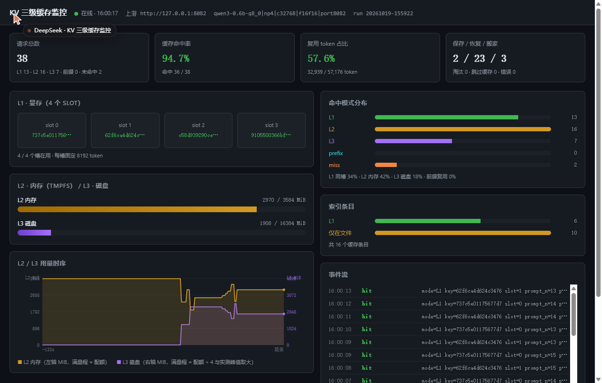

# 进阶项目 · 开发区域

**选题**：方向一 · KV 缓存管理与复用优化
**做法**：在 llama.cpp 前面加一层**缓存代理**，把"文档的 KV"当成可复用的资产，
按 **显存 → 内存 → 磁盘** 三级管理，并解决共享池"会清 KV"的问题。

---

## 1. 选题、场景与优化目标

### 场景

一个 7 人工作室反复查询同一批项目资料、代码与制度文档。
每次请求都要把同一份文档从头算一遍（prefill），这是纯粹的重复劳动。

### llama.cpp 现状与本项目的补足

| 能力 | llama.cpp | 本项目 |
|---|---|---|
| 同一 slot 内前缀复用 | ✅ 默认开启 | 直接利用 |
| 跨 slot 复用 | ⚠️ 靠 `--cache-ram`，非共享池下**双份内存**且**满了直接丢** | ✅ 显式 restore |
| 跨服务重启 | ❌ 需手动 `--slot-save-path`，无自动迁移 | ✅ L3 磁盘层 |
| 按容量分层与迁移 | ❌ 没有 | ✅ L1/L2/L3 + 整批搬家 |
| 文档轻微改动 | ❌ 整篇重算 | ✅ 前缀块指纹 + 路由复用 |
| 可观测 | ❌ 只有零散日志 | ✅ 事件日志 + `/admin/status` |

### 优化目标与判断依据

| 目标 | 判断依据 |
|---|---|
| 提高复用率 | 缓存命中率、复用 token 占输入 token 比例 |
| 缩短重复请求 TTFT | 命中时 prefill 耗时 vs 全量重算 |
| 三层按需使用 | 各层占用曲线；**磁盘只在内存用满后才增长** |
| 迁移不破坏缓存 | 迁移后仍能 restore；文件 sha256 一致 |
| 可观测 | `results/<run_id>/events.jsonl` + `/admin/status` |

---

## 2. 系统结构

```
                ┌──────────────────────────────────────────┐
   客户端  ───▶  │  缓存代理  127.0.0.1:8091                │
                │  ① 算缓存键（文档内容 + 配置指纹）        │
                │  ② 查索引：命中哪一层                    │
                │  ③ 直接转发 / restore / 全量算            │
                │  ④ 算完 save 到 L2                       │
                │  ⑤ 容量管理：L2 超限 → 整批搬 L3         │
                │  ⑥ 事件与指标                            │
                └───────────────┬──────────────────────────┘
                                │ HTTP（OpenAI 兼容 + /slots 控制）
                                ▼
                ┌──────────────────────────────────────────┐
                │  llama-server  127.0.0.1:8092             │
                │  -c 32768 -np 4   → 4 槽 × 8192 token     │
                │  --cache-ram 0    → 关掉内建缓存          │
                │  --slot-save-path /dev/shm/antlab_kv/L2/  │
                └──────────────────────────────────────────┘

   三层：
     L1 显存   4 slot × 896 MiB（= 8192 token × 112 KiB）
     L2 内存   /dev/shm/antlab_kv/L2   配额 3.5 GiB（tmpfs）
     L3 磁盘   kv_cache/L3             配额 16 GiB
```

### 目录

```
development/
├─ README.md                  ← 本文件（项目入口，复现索引见 §12）
├─ proxy/                     缓存代理 · 本项目主要代码（4 模块 1421 行）
│   ├─ proxy.py               主流程：路由 / slot 管理 / 容量维护 / HTTP
│   ├─ slotfile.py            .bin 文件头读取 + 前缀块指纹
│   ├─ store.py               L2/L3 文件管理 + 整批搬家 + 淘汰
│   └─ index.py               索引：原子写 + 崩溃重建
├─ configs/
│   ├─ cache.json             端口 / 配额 / 指纹 / 阈值
│   └─ workloads/S1..S6.json  六个固定负载（含每条请求的到达时刻）
├─ corpus/                    自建语料（15 份，约 970 / 5620 token 两档）
│   ├─ small/                 8 份小文档
│   ├─ large/                 5 份大文档
│   ├─ versions/              知识库 v1 / v2（测轻微改动，公共前缀 98.4%）
│   └─ manifest.json          每份的字节数 / sha256 / token 数
├─ tests/                     测试（9 文件 1461 行，合计 192 项断言）
│   ├─ run_all.sh             全跑；`run_all.sh unit` 只跑不需要服务的 152 项
│   ├─ _lib.py                断言与汇总
│   ├─ test_key.py            缓存键与请求拆分（16 项）
│   ├─ test_slotfile.py       .bin 格式与块指纹（26 项）
│   ├─ test_index.py          索引持久化与崩溃重建（31 项）
│   ├─ test_migrate.py        三层搬家与配额（51 项）
│   ├─ test_evict.py          LRU 淘汰（28 项）
│   ├─ test_e2e.py            端到端四条主路径（20 项，需服务）
│   └─ test_faults.py         S8 五类异常（20 项，需服务）
├─ tools/                     复现与验证工具（14 文件 2528 行）
│   ├─ start_adv.sh           独占启动（先停基础项目并校验端口释放）
│   ├─ stop_adv.sh            按 SIGINT → TERM → KILL 顺序停
│   ├─ use.sh                 basic / adv / status / stop-all 一键切换
│   ├─ gen_corpus.py          生成语料（用服务端 tokenizer 精确计数）
│   ├─ gen_workloads.py       生成 S1..S6 负载定义
│   ├─ replay.py              负载回放器（--target proxy|baseline）
│   ├─ bench_matrix.py        基线 vs 优化 跑批（多场景 × 多轮）
│   ├─ make_matrix_table.py   从已有结果生成对比表（不重跑）
│   ├─ verify_claims.py       只用原始数据核对报告结论
│   ├─ test_spill.py          L2→L3 整批搬家专项
│   ├─ fill_l3.py             灌满 L2 观察搬迁
│   ├─ probe_determinism*.py  输出确定性实验（全量 / 恢复 / 命中）
│   ├─ make_report_assets.py  从 summary.json 生成报告配图
│   └─ smoke_test.sh          四条主路径冒烟
├─ results/                   原始记录 · 9 次保留运行
│   ├─ README.md              ← 运行索引、文件说明、统计口径、已知缺口
│   ├─ _summary/matrix.md     基线 vs 优化对比表
│   └─ <运行编号>/             requests.jsonl（逐请求）
│                             tiers.csv（250 ms 采样三层容量）
│                             summary.json（汇总）
│                             run-config.json（复现用参数）
│                             run.log（过程日志）
├─ reports/                   书面报告
│   ├─ 进阶阶段考核报告.md     ← 12 章考核报告
│   └─ img/                   报告配图（SVG 由 make_report_assets.py 生成）
├─ web/                       监控面板（单页 402 行，原生 JS，零依赖）
│   ├─ index.html             由代理托管在 http://127.0.0.1:8091/
│   └─ screenshot.png         面板截图
├─ kv_cache/                  L3 磁盘缓存（不进仓库）
├─ logs/                      运行日志（不进仓库）
└─ .runtime/                  pid 文件（不进仓库）
```

## 3. 环境与依赖

| 项 | 版本 / 位置 |
|---|---|
| llama.cpp | `~/antlab/src/llama.cpp` · build `b1-9bf55f4`· `llama-server` |
| 模型 | `~/antlab/models/Qwen3-0.6B-Q8_0.gguf` |
| Python | 3.12，**零第三方依赖**（只用标准库） |
| GPU | RTX 5060 Laptop，8151 MiB |
| 内存 | 11814 MiB |

**本项目不修改 llama.cpp 源码**，只通过它的 HTTP 接口（`/v1/chat/completions`、
`/slots/{id}?action=save|restore|erase`、`/tokenize`、`/props`）控制。

---

## 4. 启动 / 停止

```bash
cd "Advanced Task/development"

# 启动（会自动停掉占着显存的旧进程，包括基础项目的服务）
bash tools/start_adv.sh

# 查看状态
curl -s http://127.0.0.1:8091/admin/status | python3 -m json.tool

# 停止
bash tools/stop_adv.sh
```

**端口约定**：

| 端口 | 用途 |
|---|---|
| 8080 | **基础项目**（本项目绝不占用） |
| 8091 | 本项目的缓存代理 |
| 8092 | 本项目的 llama-server |

### L2 用 tmpfs 的原因

`--slot-save-path` 指向 `/dev/shm/antlab_kv/L2`（tmpfs）。
这样"保存 KV"落在**内存**而不是磁盘，速度接近内存，而且用量可以用 `df` 精确监控、
超配额时用普通文件操作整批搬到 L3。

**不建议改成 `--cache-ram`**，因为实测它有三个问题：

1. 非共享池下它是**复制**而不是搬走 → 显存 + 内存**双份**
2. 满了之后**直接丢弃**，不转存磁盘 → 无法实现"内存用完才用磁盘"
3. 没有任何接口能读出缓存的某一条 → 代理无法把它搬走

> 如果要固定 `/dev/shm` 配额（默认是内存的一半 = 5.8 GiB）：
> `sudo mount -o remount,size=4G /dev/shm`

---

## 5. 请求约定

代理按「前缀 + 问题」的结构识别可缓存部分：

```jsonc
{
  "messages": [
    {"role": "system", "content": "..."},
    {"role": "user",   "content": "文档全文"},   // ← 前缀，被缓存
    {"role": "user",   "content": "问题"}        // ← 每次都变
  ],
  "max_tokens": 96,
  "temperature": 0.0,
  "chat_template_kwargs": {"enable_thinking": false}
}
```

**代理取 `messages[:-1]` 作为前缀**，算缓存键。

> Qwen3 是思考模型，不关掉 `enable_thinking` 时 `max_tokens` 会全被推理占掉，
> 返回的 `content` 是空的。

响应里会多一个字段，供回放器统计：

```jsonc
"_proxy": {"mode": "L1|L2|L3|prefix|miss|passthrough",
           "key": "...", "slot": 0, "reused_tokens": 995,
           "proxy_wall_ms": 187.3}
```

---

## 6. 基线与优化配置

| 组 | 配置 |
|---|---|
| **基线** | 直连 `127.0.0.1:8092`，不经过代理，不做任何缓存 |
| **优化** | 经过代理（`:8091`）+ tmpfs L2 + 磁盘 L3 |

两次都用同一份 `configs/cache.json`（除了代理开关），
`server_fingerprint` 必须一致，否则旧缓存作废。

---

## 7. 复现方法

```bash
# 1) 生成语料（需要服务在线，以便用服务端 tokenizer 计数）
python3 tools/gen_corpus.py

# 2) 清空缓存状态，从零开始
rm -rf /dev/shm/antlab_kv kv_cache/L3 kv_index.json results/_live

# 3) 重启
bash tools/start_adv.sh

# 4) 跑场景（见下一节）
```

---

## 8. 已实现的路径与实测结果

冒烟测试（`tools/smoke_test.sh` 的一次运行）：

| 路径 | 现象 | 关键数字 |
|---|---|---|
| ① 首次 | miss → 算 → save 到 L2 | 1010 token, prefill 64 ms, save 117 MiB |
| ② 再问同一文档 | **L1 命中** | prefill 13 ms，复用 995 token |
| ③ 连塞 5 份新文档 | miss + 腾槽（erase）+ save | 每份 prefill 48~57 ms |
| ④ 回头问被挤掉的文档 | **L2 命中**（从 tmpfs restore） | restore 27 ms + prefill 9 ms |
| ⑤ 轻微改动 v1→v2 | **prefix 命中** | 只算 **72** token（复用 3257），prefill 12 ms；输出正确用 v2 事实 |

---

## 9. 已知限制与踩坑记录

### 9.1 硬限制（改不了，只能绕）

1. **单请求 ≤ 每槽容量（8192 token）**：`-np 4` 下每槽固定 8192，
   超了 llama.cpp 直接返回 400，任何缓存技巧都救不了。
2. **缓存绑定启动配置**：`-c` / `-np` / KV 量化变了，旧缓存 restore 会失败。
   `server_fingerprint` 已把这一点纳入缓存键，并在启动时**主动清理**
   别的配置留下的缓存文件（事件 `stale_config_evict`）。
3. **磁盘文件要自己删**：llama.cpp 完全不管磁盘，配额与淘汰都在代理里做。
4. **`erase` 不保存任何东西**：必须先 `save` 再 `erase`。
5. **`--slot-save-path` 只有一个目录**：llama-server 读不到 L3 的文件，
   所以 L3 命中要先把它复制回 L2（一次 624 MiB 的复制，约 1.2 s）。

### 9.2 两处我一开始写错、后来被测出来纠正的事实

| # | 原来的说法 | 实测纠正 |
|---|---|---|
| 1 | 「L2 是 tmpfs，**重启即失**，冷启动只能靠 L3」 | ❌ 错。**tmpfs 是文件系统，进程重启不会清空它**。只有重启 WSL / 主机才会没。实测：服务重启前后 L2 都是 1889 MiB。所以 L3 的真正价值是**跨主机重启**和**更大容量**，不是"跨服务重启"。 |
| 2 | 「同一问题，有缓存与无缓存的输出应**逐字相同**」 | ❌ 做不到。**前缀复用会改变 `n_past`** → 批量组成不同 → 浮点归约顺序不同 → 贪心解码可能选到不同 token。实测出现「资料**分为**三级」vs「资料**分**三级」。已改为断言「**关键事实一致**」，见 `tools/probe_determinism2.py`（全量路径自身连续两次是逐字相同的，差的是"全量 vs 命中"之间）。 |

### 9.3 实现层面的坑（都写进了单元测试，防回归）

| # | 坑 | 怎么发现的 |
|---|---|---|
| 1 | `.bin` 的 token 区是 `server_tokens::serialize()` 的**打包格式**，第 2 个元素是 token 数，拿它做逐 token 比较 LCP 恒为 1 | 冒烟测试里 v1/v2 的 prefix 命中一次都没触发 |
| 2 | `save` 之后**槽里的 KV 还在**，不能把 `tier` 降成 L2（否则同一文档会被复制到两个槽） | 冒烟测试里 alpha 同时占了 slot 0 和 1 |
| 3 | `tier`（在不在显存）与 `file_tier`（文件在哪层）必须分开 | 状态面板把"仅在文件"的条目错显示成 L2 |
| 4 | L3 淘汰的目标若只按"配额 × 20%"，超出量更大时会删不够 | `test_evict.py` 的"删完不超配额" |
| 5 | `Index.add` 的默认 `tier="L2"` 会让"文件没了"的条目识别不出来 | `test_index.py` 的对账测试 |
| 6 | 外部清空 slot 后代理的槽位映射会陈旧，后续请求白白全量重算 | `probe_determinism2.py`；已加 `stale_slot` 检测与自动修正 |
| 7 | 换配置后旧指纹的缓存永远不可能命中，却一直占着配额 | `test_faults.py` ⑤；已加启动清理 |

---

## 10. 隔离承诺（不影响基础项目）

| 措施 | 说明 |
|---|---|
| 目录 | 只写 `Advanced Task/development/`，**不改 `Basic Task/` 任何文件** |
| 端口 | 8080 留给基础项目；本项目用 8091 / 8092 |
| 服务 | 自己的 `start_adv.sh` / `stop_adv.sh` + 独立 pid 文件 |
| 缓存 | `/dev/shm/antlab_kv/` 与 `kv_cache/` 都在本项目内 |

**验证**：跑完进阶全程后，在仓库根执行
`git status --porcelain "Basic Task"` 应输出为空。

---

## 11. L2 → L3 整批搬家：实测验证

`tools/test_spill.py` 把 L2 配额临时压到 **1 GiB**，灌 13 份文档（8 小 ≈113 MiB + 3 大 ≈624 MiB + v1/v2），
观察三层曲线与搬家批次。

### 结果

| 轮次 | 现象 |
|---|---|
| 第一轮 1~8 份 | L2 从 0 涨到 920 MiB，**L3 始终为 0** ← 磁盘没被提前用到 |
| 第一轮 第 9 份 | L2 已满，触发搬家：**批次 1 = 9 个文件 / 1544 MiB / 3454 ms** |
| 第一轮结束 | L2 733 MiB（配额内），L3 2792 MiB，`spills=5 skip_cache=0` |
| **第二轮** | **13 份文档全部 L3 命中**，`prompt_n=17`（几乎不重算） |
| 完整性 | L3 里 11 个文件逐个读头部，**0 个损坏** |

### 四条设计目标逐条对照

| 目标 | 实测证据 |
|---|---|
| 磁盘**只在内存满了才用** | 前 8 份文档 L3 = 0；第 9 份才首次增长 |
| 搬家是**整批**不是滴漏 | 批次 1 含 **9 条**（一次搬 1544 MiB，目标 = 配额 × 30%） |
| 搬家**不破坏**缓存 | 第二轮 13 份全部 L3 命中；11 个文件全部可解析 |
| 搬家后 L2 **回落到配额内** | 733 MiB < 1024 MiB |

### ⚠️ 搬家过程中发现的一个真实代价

`--slot-save-path` **只能指定一个目录**，llama-server 无法直接读 L3 的文件。
所以 **L3 命中时，必须先把文件从磁盘复制回 L2**，才能 restore：

```
L3 命中 → 复制 624 MiB 回 L2（约 1.2 s）→ restore（约 0.2 s）→ 开始算
```

这就是"磁盘层"的真实成本，已经计入事件日志的 `promote` 事件。

**可优化方向（尚未实现）**：在 L2 目录里放一个**指向 L3 文件的符号链接**，
llama-server 按路径打开，符号链接可以直接透传到磁盘文件，省掉整次复制。
代价是 `df`/目录用量统计要额外处理（符号链接本身几乎不占空间），
且 restore 变成真正的磁盘读（更慢但省内存）。留作后续优化。

---

## 12. 回放器 `tools/replay.py`

按负载定义定时投递请求，采集逐请求原始数据、三层容量曲线与汇总。

```bash
# 优化组（经过代理）
python3 tools/replay.py --workload configs/workloads/S4.json

# 基线组（直连模型服务，无缓存）
python3 tools/replay.py --workload configs/workloads/S4.json --target baseline

# 多轮
python3 tools/replay.py --workload configs/workloads/S4.json --rounds 3

# 重启后跑（L2 清空、L3 保留）——测磁盘层
python3 tools/replay.py --workload configs/workloads/S6.json --restart-first
```

**输出**（每次运行一个目录 `results/<label>-<target>-<时间戳>/`）：

| 文件 | 内容 |
|---|---|
| `requests.jsonl` | 逐请求：计划/实际到达时刻、`arrival_dev_ms`、模式、槽位、`prompt_n`、复用 token、prefill/gen 耗时、完整回答 |
| `tiers.csv` | 250 ms 采样的三层容量序列（`l1_slots_used,l2_used,l2_quota,l3_used,l3_quota,entries,requests`） |
| `summary.json` | 汇总：模式分布、命中率、复用比例、prefill 的 sum/p50/p95、每文档拆分 |
| `run-config.json` | 本次全部参数 + 语料清单，用于复现 |
| `run.log` | 人可读过程日志 |

**负载定义**（`configs/workloads/*.json`，由 `tools/gen_workloads.py` 生成）：

| 文件 | 请求 | 文档 | 跨度 | 目的 |
|---|---:|---:|---:|---|
| S1 | 10 | 1 | 10.8 s | 单文档重复，测最高命中率 |
| S2 | 24 | 8 | 16.1 s | 小文档轮转，槽只有 4 个 → 换入换出 |
| S3 | 15 | 3 | 35.0 s | 大文档竞争 |
| S4 | 35 | 11 | 31.4 s | 热 2×10 + 温 3×3 + 冷 6×1 → 测淘汰 |
| S5 | 6 | 2 | 10.0 s | v1 → v2，测失效判定与前缀复用 |
| S6 | 9 | 3 | 20.0 s | 配合 `--restart-first` 测跨重启 |

---

## 13. 前端监控面板

代理同时托管一个单文件监控页：**http://127.0.0.1:8091/**

零依赖（纯 HTML + 原生 JS + Canvas），每 600 ms 拉一次 `/admin/status`、每 1.5 s 拉一次 `/admin/events`。

**展示内容**

| 区块 | 内容 |
|---|---|
| 顶部 KPI | 请求总数、缓存命中率、复用 token 占比、保存/恢复/搬家次数 |
| **L1 · 显存** | 4 个 slot 方块，显示各自装的是哪个缓存键（绿色）/空闲（虚线） |
| **L2/L3 容量** | 内存与磁盘两条进度条，含已用/配额 |
| **用量时序** | Canvas 折线：左轴 L2 MiB，右轴 L3 MiB，能直接看到"L2 满 → 降到阈值 / L3 台阶式上升"的搬家特征 |
| 命中模式分布 | L1 / L2 / L3 / prefix / miss 的条形图 |
| 索引条目 | 在显存（L1）/ 仅在文件 / 失效 的条目数 |
| 事件流 | 最近 40 条事件，按类型着色（hit/miss/save/restore/migration/spill/promote/evict） |



> 截图对应的状态：L1 命中 13、L2 命中 16、L3 命中 7，
> 命中率 94.7%，复用 token 57.6%。
> 时序图里能直接看到 **L2 涨满 → 搬家后回落 → L3 台阶上升** 的联动。

---

## 14. 结果

### 14.1 基线 vs 优化（每个场景 3 轮）

> **基线** = 直连 llama-server:8092，不经过代理。
> 注意它**不是"零缓存"** —— llama.cpp 原生就有同槽前缀复用，所以基线也有复用率。
> **优化** = 经过代理（L1 显存 / L2 tmpfs / L3 磁盘）。

| 场景 | 组 | 请求 | 命中率 | 复用 token | prefill 合计 (ms) | 各轮 (ms) |
|---|---|---:|---:|---:|---:|---|
| **S1** 单文档重复 | 基线 | 30/30 | 0.0% | 96.4% | 773.9 | 513 / 131 / 129 |
| | 优化 | 30/30 | 96.7% | 96.4% | 725.9 | 466 / 134 / 125 |
| | **提升** | | | | **6%** | |
| **S2** 小文档轮转 | 基线 | 72/72 | 0.0% | **2.1%** | 3993.2 | 1366 / 1289 / 1339 |
| | 优化 | 72/72 | 88.9% | 87.9% | 1045.7 | 612 / 215 / 219 |
| | **提升** | | | | **74%** | |

模式分布：S1 优化组 `{miss:1, L1:29}`；S2 优化组 `{miss:8, L2:64}`。

### 14.2 这两行数字说明什么（最重要的一段）

**S1：代理几乎没用（+6%）**

一份文档、10 次重复，它本来就装得进一个槽。
llama.cpp 原生的同槽前缀复用已经拿到 **96.4%** 的复用率 —— 代理能做的只有把
"第一次 miss" 变成"从 L2 恢复"，收益很小。

> **结论：如果工作负载是"反复问同一份文档"，不需要做这个项目。**

**S2：代理把 prefill 砍掉 74%**

8 份文档、只有 4 个槽。基线每次轮转都会落到一个装着**别的**文档的槽上，
复用率只有 **2.1%** —— 等于每次都在全量重算。
代理把所有文档的 KV 放在 L2（tmpfs）里，需要时恢复进槽，
复用率 **87.9%**，每轮 prefill 从 1339 ms 降到 219 ms。

> **结论：缓存的收益来自"工作集大于槽位数"，而不是"重复"本身。**

### 14.3 单轮场景数据（补充，未做基线对照）

| 场景 | 请求 | 模式分布 | 命中率 | 复用 token |
|---|---:|---|---:|---:|
| S3 大文档竞争 | 15 | L1 ×12, L2 ×1, miss ×2 | 86.7% | 86.4% |
| S5 版本更新 | 6 | L1 ×4, L2 ×2 | 100% | 99.8% |
| S4 冷热混合（冷启动） | 35 | L1 ×12, L2 ×12, prefix ×1, miss ×10 | 71.4% | 60.9% |
| S4 冷热混合（缓存已热） | 35 | L1 ×13, L2 ×16, L3 ×6 | 100% | 72.8% |

**尚未完成**

- S3 / S4 / S5 的 3 轮基线对照。跑批时 llama-server 在 S3 基线的某个请求上挂住
  （客户端等 900 s 超时，代理与模型都空闲），两次重跑都在同一位置复现。
  已给回放器加看门狗（每轮上限 = 最后到达时刻 + 600 s）与单请求 240 s 超时，
  但**这三组的对照数据仍缺**，报告里不能当已完成。
- S6 跨重启（需要先预热 L3 再 `--restart-first`）。
- 统计显著性（3 轮只有中位数，没有置信区间）。

---

## 15. 测试

```bash
bash tests/run_all.sh        # 全部（单元 + 端到端）
bash tests/run_all.sh unit   # 只跑不依赖服务的单元测试
```

| 文件 | 断言什么 | 断言数 |
|---|---|---:|
| `test_key.py` | 缓存键可复现；改一个字键就变；换配置键就变；消息拆分规则 | 16 |
| `test_slotfile.py` | `.bin` 文件格式与魔数（0x67677371 / v3）；坏文件识别；前缀块指纹；**固化"token 区是打包格式"这个事实** | 26 |
| `test_index.py` | 持久化往返；原子写不留半个 JSON；**对账（文件为准）**；`tier` 与 `file_tier` 语义 | 31 |
| `test_migrate.py` | 复制校验（sha256）；整批搬家的批量与配额；引用计数跳过；提升；淘汰 | 51 |
| `test_evict.py` | 未超配额不删；按 LRU 删；**删到回到配额内**；只删 L3；不留幽灵条目 | 28 |
| `test_e2e.py` | miss→命中；**v2 不返回 v1 的旧事实**；输出关键事实一致；请求取消不崩；坏请求 400 | 20 |
| `test_faults.py` | **S8 异常场景**：文件被删/被截断/索引损坏/服务重启/配置变更 | 20 |
| **合计** | | **192** |

### 15.1 测试理念（和基础项目一致）

1. **每个断言要说明断言什么** —— 名字写清楚，不写"测试通过"这种空话
2. **期望值必须有独立来源** —— 魔数来自源码 `llama.h`；LCP 结果能手算；
   配额判断用构造数据。**不拿系统自己的输出验证系统自己**
3. **模型输出的"质量"不算测试通过/失败** —— 那是模型能力，不是流水线正确性
4. **发现的坑要写成测试** —— 见 §9.3 的七条

### 15.2 两个容易误判的地方

| 现象 | 正确理解 |
|---|---|
| 同一问题的回答在"命中"和"全量"之间差一两个字 | **不是 bug**，是前缀复用改变了数值路径（§9.2）。断言应落在"关键事实"上 |
| 服务重启后 L2 用量没变 | **正常**。tmpfs 是文件系统，进程重启不清空它（§9.2） |

---

## 16. 结论核对脚本

```bash
python3 tools/verify_claims.py     # 用 results/ 里的原始数据核对计划书 §10.3 的七项
python3 tools/bench_matrix.py      # 基线 vs 优化，每场景 3 轮，产出对比表
python3 tools/probe_determinism2.py  # 输出确定性实验（全量 / L2恢复 / 同槽命中）
python3 tools/test_spill.py        # L2→L3 整批搬家专项
```

`verify_claims.py` 的原则：**只读 `results/` 下已有的数据，不重新推理**。
凡是数据里看不出来的，明确打印"⚠️ 未能核对"，绝不写成"通过"。

七项对应关系：

| # | 计划书里的结论 | 怎么核对 |
|---|---|---|
| ① | 磁盘只在内存满了之后才增长 | 读 `tiers.csv`：`l3_used` 首次 > 0 时，`l2_used / l2_quota` 必须 ≥ 85% |
| ② | L2→L3 是整批搬家 | 读事件里的 `spill_done`：批次数 > 1，且释放量 ≥ 目标（配额 × 30%） |
| ③ | 迁移不破坏缓存 | 读 `requests.jsonl`：所有 `mode=L3` 的请求 success 且 `prompt_n < 300` |
| ④ | v1/v2 不互相命中 | 读 S5 运行：v2 的回答含 14 天、不含残留的 7 天 |
| ⑤ | 配置变更后旧缓存作废 | 读索引：所有条目的 `fp` 都等于当前指纹；有 `stale_config_evict` 事件 |
| ⑥ | 崩溃恢复 | 读 `proxy_start` 事件里的 `reconcile` 补登记数量 |
| ⑦ | 输出不受影响 | **已修正为"关键事实一致"**，见 §9.2 |


