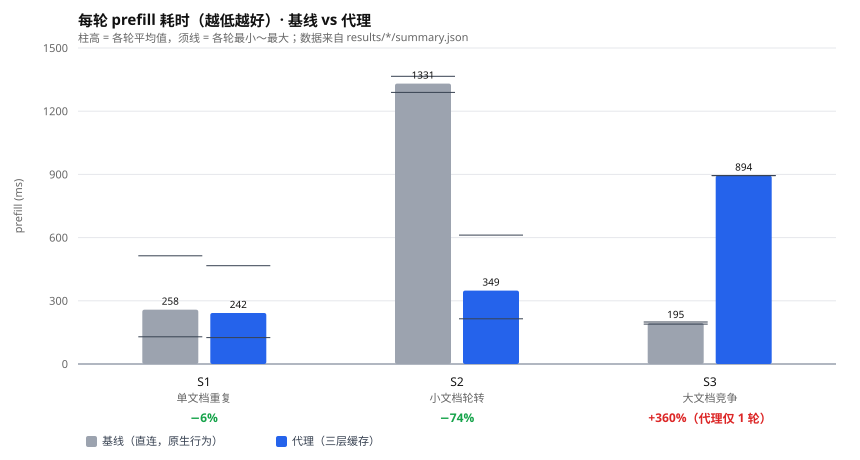

# 进阶阶段考核报告

**姓名**：王志博

**项目名称与选题**：ANTLab 推理服务 · 方向一 **KV 缓存管理与复用优化**

**GitHub 仓库、分支与最终 commit SHA**：
`https://github.com/YINXIA-LEARN/ANTLab-Infra-Tasks` · 分支 `master`
· **代码与数据的最终提交**：`9791972`
  （`feat(basic): 新增演示预设 demo-c4-r1`，此前 7 个提交为进阶阶段开发过程）
· **本报告文字的最终提交**：`9a92c90`（其后仅可能的文档修订）
· 核实：`git log --oneline 9791972` 与 `git log --oneline 9a92c90`
  可查到完整 SHA；`git diff 9791972 master -- "Advanced Task/development/proxy"` 
  应为空，说明代码自该提交起未再变动

**完成日期**：2026-10-19

---

## 1. 应用场景与问题

### 1.1 服务对象与请求特点

服务对象是一个小型工作室的办公与编程助手。请求形态高度集中：

- **长前缀 + 短问题**。每次请求都带一份完整文档（1 000～6 000 token）作为上下文，
  后面跟一句几十 token 的问题。
- **工作集小但轮转快**。常用文档约 8～13 份，反复被问到，但**每次问的可能不是同一份**。
- **突发性**。用户打开一个项目就连问十几次，然后换到另一个项目。

### 1.2 已有表现（继承自基础阶段的实测）

基础阶段的系统把 llama.cpp 的 `-c` 提到 32768，四个 slot 作为**一个共享池**
（`kv_unified=true`）使用。在这种配置下观察到两个现象：

| 现象 | 实测依据 |
| --- | --- |
| **同一份文档反复问，很快** | 前缀复用，第二次起 prefill 只有 130 ms 量级 |
| **不同文档轮转，每次都慢** | 复用到的是**别的**文档留下的 KV，实际接近全量重算 |

第二点是本阶段的切入点。根因是：**llama.cpp 的 KV 缓存是「槽内」的，不是「全局」的。**
一个 slot 里只能放一份前缀，换一份文档就得覆盖。

### 1.3 拟解决的问题与优化目标

**问题**：缓存无法跨 slot、跨进程存活，导致工作集大于槽位数时命中率崩塌。

**优化目标**（可量化）：

1. 工作集大于槽位数的场景下，把前缀复用率从个位数拉高到 80% 以上；
2. 缓存能跨服务重启存活（今天重启就全丢）；
3. 显存、内存、磁盘三级各司其职，且**只有内存用满才动磁盘**；
4. 文档有轻微改动时，只重算改动部分，而不是整篇重算。

**功能范围**：只做缓存层，不改 llama.cpp 源码、不改模型、不改 tokenizer。
基础阶段的服务（8080 + 8000）**一行代码都不动**，进阶系统完全独立。

---

## 2. 调研与方案选择

### 2.1 参考的接口与版本

| 项目 | 版本 / commit | 用途 |
| --- | --- | --- |
| llama.cpp | `b1-9bf55f4`（`version: 0.5.0-dev`） | 推理服务本体，直接用其二进制，未改源码 |
| `GET /slots` | 同上 | 查看槽位状态（**实测不完全可靠**，见 §4.4） |
| `POST /slots/{id}?action=save` | 同上 | 把某个槽的 KV 落盘为 `.bin` |
| `POST /slots/{id}?action=restore` | 同上 | 把 `.bin` 读回某个槽 |
| `POST /slots/{id}?action=erase` | 同上 | 清空某个槽 |
| `POST /tokenize` | 同上 | 精确计数 token（用于算块指纹） |
| `--slot-save-path` | 同上 | 指定 save 目录（**单个目录**，不支持分级） |
| `--cache-ram` | 同上 | 内建的 CPU 侧缓存（**本项目刻意不开**，理由见 §2.3） |

### 2.2 方案选择

**选定方案：在 llama.cpp 前面加一个 Python 缓存代理（:8091），
自己维护「缓存键 → KV 文件 / 槽位」的索引，按需 save / restore。**

对比过的其他三条路：

| 方案 | 为什么没选 |
| --- | --- |
| 改 llama.cpp 源码，做全局 KV 池 | 需要动 C++ 推理路径，风险高、复现难；且题目允许在应用层做 |
| 直接用 `--cache-ram` | 三个硬问题，见 §2.3 |
| 只用一个 slot + 自己排队 | 并发直接归零，与「多并发」的考核项冲突 |

### 2.3 为什么不用 llama.cpp 自带的 `--cache-ram`

这是本阶段最关键的一个技术判断，三条实测理由：

1. **非共享池下它是「复制」不是「搬走」。**
   `--cache-ram` 把空闲 slot 的 KV 拷到主机内存，**显存里那份不释放**。
   实测两份文档算完后进程 RSS 增加 410 MiB，而显存里两份都还在 —— 内存白花。
2. **满了之后直接丢弃，不落磁盘。**
   源码 `server-task.cpp` 里是 `pop_front` 语义，**永远不会溢写到磁盘**。
   这与「显存→内存→磁盘分级」的目标直接冲突。
3. **没有任何接口能把缓存里的某一条读出来。**
   只有 `/slots/N?action=save`，而那是从**显存**存的。等于拿不到「内存层」的内容。

因此改用 **tmpfs 目录 + 代理自己维护索引**：

```
--slot-save-path /dev/shm/antlab_kv/L2/     ← 文件真的住在内存里
```

好处：用量能 `df` 精确读、搬家就是普通文件操作、进程重启后文件还在。

### 2.4 自己的开发内容 vs 继承内容

| 类别 | 内容 |
| --- | --- |
| **继承（基础阶段，commit `bc98d9a`）** | 服务启停脚本、控制层与网页、10 个规定任务的输入、基准测试程序、指标定义 |
| **本阶段新增（全部自己写）** | `proxy/` 4 个模块 1 421 行；`tests/` 9 个文件 1 461 行；`tools/` 14 个文件 2 528 行；`web/` 单页面板 402 行 |
| **对基础阶段的修改** | **无**。`git status "Basic Task"` 为 0（新增的演示预设除外，见 §11.3） |
| **对 llama.cpp 的修改** | **无**。只用其公开 HTTP 接口 |

---

## 3. 环境与复现条件

| 项目 | 信息 |
| --- | --- |
| GPU、显存 | NVIDIA GeForce RTX 5060 Laptop GPU · **8 151 MiB** · 驱动 573.22 |
| CPU | 13th Gen Intel Core i7-13700HX |
| 内存 | 11 814 MiB |
| 磁盘 | 1 007 GB（可用 925 GB）；`/dev/shm` 5.8 GB |
| Windows / WSL / Linux | Windows 11 · WSL2 · Ubuntu 24.04.4 LTS · 内核 6.6.87.2-microsoft-standard-WSL2 |
| 驱动及 CUDA | 驱动 573.22；未单独安装 `nvcc`（使用预编译 llama.cpp，走 CUDA 运行时） |
| llama.cpp 版本 | `b1-9bf55f4`（`version: 0.5.0-dev`，GNU 13.3.0 编译） |
| 模型来源、版本、量化 | `Qwen3-0.6B-Q8_0.gguf` · 639 446 688 字节 · SHA256 `9465e63a22add5354d9bb4b99e90117043c7124007664907259bd16d043bb031` |
| 模型权重和计算位置 | 权重全量上卡（`-ngl 99`），计算全部在 GPU |
| 上下文、输出预算、并发、slot | `-c 32768`；`max_tokens` 按场景 256～1024；`-np 4`（4 个 slot） |
| KV 类型 | f16 / f16（**未**量化为 q8_0，见 §7 改动 C-4 的取舍） |
| **各层容量与存放位置** | **L1 显存** 4 slot × 8 192 token（每槽 896 MiB，启动时预分配，`/dev/shm/antlab_kv/L2/` 见下）；**L2 内存** `/dev/shm/antlab_kv/L2/`（tmpfs，配额 3 584 MiB）；**L3 磁盘** `kv_cache/L3/`（配额 16 GiB） |
| 决策模型 | **未采用**（方向一不涉及调度决策） |

**KV 单 token 成本（手算 + 实测一致）**：

```
2（K 和 V）× 28 层 × 8 个 KV head × 128 head_dim × 2 字节（f16） = 114 688 字节
```

实测拟合：1 006 / 2 906 / 10 905 / 11 646 token 四个数据点，每 token **114 704 字节**，
与手算差 16 字节（0.014%），差异来自每序列的元数据头。

**复现入口**：见 `development/README.md` 第 4 节「启动与复现」，
以及本报告 §12 的复现索引。

---

## 4. 系统设计与实现

### 4.1 结构图

```
                     客户端（OpenAI 兼容请求）
                              │  messages = [system, {user: 文档全文}, {user: 问题}]
                              ▼
        ┌──────────────────────────────────────────────────────────┐
        │           缓存代理  proxy/proxy.py    :8091               │
        │                                                          │
        │  split_messages()  最后一条是「问题」，前面都是「前缀」      │
        │        │                                                 │
        │        ▼                                                 │
        │  cache_key() = sha256(前缀 + 配置指纹)[:16]                │
        │        │                                                 │
        │        ▼                                                 │
        │  查索引 kv_index.json                                     │
        │        │                                                 │
        │        ├─ ① L1 命中 ──→ 直接转发到那个 id_slot            │
        │        ├─ ② L2 命中 ──→ restore 进空槽 → 转发             │
        │        ├─ ③ L3 命中 ──→ promote 回 L2 → restore → 转发    │
        │        ├─ ④ 前缀相似 ──→ restore 旧的，把新请求发给同槽     │
        │        └─ ⑤ 全 miss ──→ 全量算 → 算完 save 到 L2          │
        │                                                          │
        │  _maintain()  L2 超配额 → 整批搬 L3；L3 超配额 → LRU 淘汰   │
        └──────────────────────────────────────────────────────────┘
                              │  POST /v1/chat/completions  (带 id_slot)
                              ▼
        ┌──────────────────────────────────────────────────────────┐
        │      llama-server  :8092   -c 32768 -np 4 --cache-ram 0   │
        │      --slot-save-path /dev/shm/antlab_kv/L2/              │
        └──────────────────────────────────────────────────────────┘
```

### 4.2 状态流转（一个缓存条目的生命周期）

```
   算完一份文档
        │
        ▼
   ┌─────────┐   save    ┌──────────────┐   整批搬家   ┌──────────────┐
   │ L1 显存 │ ────────→ │ L2 内存(tmpfs)│ ──────────→ │  L3 磁盘      │
   │ slot=N  │           │ 文件已存在    │             │ 文件已存在    │
   └─────────┘           └──────────────┘             └──────────────┘
        │                       │                            │
        │ 槽被别的文档占用       │ restore 回槽                │ 先 promote 回 L2
        ▼                       ▼                            ▼
   tier=None              tier=L1, slot=M              复制 620 MiB ≈ 1.2 s
   file_tier=L2                                         再 restore
```

**关键：`tier`（在不在显存）和 `file_tier`（文件在哪一层）是分开的两个字段。**
早期只有一个 `tier` 字段，`save` 之后把它降成 L2，代理就以为槽空了 ——
结果把同一份 KV 复制到了两个槽（bug #1，见 §11.1）。

### 4.3 主要模块

| 模块 | 行数 | 职责 |
| --- | ---: | --- |
| `proxy/proxy.py` | 812 | HTTP 服务、路由决策、槽位管理、容量维护、事件记录 |
| `proxy/slotfile.py` | 160 | 解析 llama.cpp 的 `.bin` 格式；前缀块指纹估算 |
| `proxy/store.py` | 300 | 文件层操作：复制校验、整批搬家、提升、LRU 淘汰 |
| `proxy/index.py` | 149 | 索引持久化（原子写）、启动对账、LRU 时间戳 |

### 4.4 关键数据结构

```jsonc
// kv_index.json 的每个条目
{
  "key": "c58d9392a1b4e7f0",        // sha256(前缀 + 配置指纹)[:16]
  "tier": "L1",                      // ⚠️ 只表示「在不在显存」
  "slot": 0,                         // 在哪个槽
  "file_tier": "L2",                 // ⚠️ 文件副本在哪一层（独立字段）
  "n_tokens": 1011,
  "bytes": 122619304,
  "fp": "qwen3-0.6b-q8_0|np4|c32768|f16f16|port8092",
  "prefix_blocks": ["a1b2…", …],     // 每 128 token 一块的 sha256[:8]
  "last_used_at": 1792396686.4,      // LRU 依据
  "use_count": 7
}
```

**为什么用「块指纹」而不是全文哈希？**
为了支持「文档轻微改动」—— 全文哈希一改就 miss，整篇重算。
改成每 128 token 一块、只存哈希（32～128 个短串），就能估算两个版本的公共前缀有多长，
再决定是否把它路由到存着旧版本的槽里，让 llama.cpp 自己做逐 token 的前缀匹配。

### 4.5 异常处理（对应 §9 的实测）

| 异常 | 处理 |
| --- | --- |
| 缓存文件被删 | 启动对账发现「索引有、文件无」→ 标 `missing` → 请求走全量 |
| 缓存文件被截断 | `restore` 返回 400 → 记 `restore_failed` → 作废条目 → 回退全量 |
| 索引 JSON 损坏 | 读失败时从**文件系统重建**（文件是权威，索引是缓存） |
| 服务重启 | tmpfs 是文件系统，L2 文件仍在；启动时对账恢复 `tier=None` |
| 配置变更（换 `-c`/`-np`/模型） | 指纹进 `cache_key` 与索引 → 启动时 `stale_config_evict` 清掉旧指纹条目 |
| 槽位被外部清空 | 响应后若 `reused==0 && prompt_total>500` → 记 `stale_slot`，修正映射 |
| 所有槽都在处理请求 | `_lru_slot` 跳过 `refcount>0` 的槽；全忙则等（上限 60 s，超时记事件） |

### 4.6 与基础阶段的隔离（重要）

| 项 | 基础阶段 | 本阶段 |
| --- | --- | --- |
| 控制层 / 面板 | `:8000` | `:8091` |
| 推理服务 | `:8080` | `:8092` |
| 预留（1.7B） | `:8081` | 不用 |
| `-np` | 无（`kv_unified=true`，共享池） | `-np 4`（固定分区） |
| `-c 32768` 的含义 | 共享池总容量 | 4 × 8 192 的总量 |
| 每槽容量 | 动态（池总量 ÷ 并发数） | 固定 8 192 |
| 配置文件 | `configs/models.json` | `configs/cache.json` |

> 早期版本把代理放在 `:8081`，与基础阶段 `compare_models.py` 里
> 「8081 = 1.7B 模型」的约定撞车。已整体迁到 8091/8092，并逐文件核实无残留引用。

---

## 5. 测试负载与判定依据

### 5.1 语料

| 类别 | 份数 | 每份 token | 来源 |
| --- | ---: | --- | --- |
| 小文档 `corpus/small/` | 8 | 约 1 000 | 自建，覆盖制度/流程/清单等办公文本 |
| 大文档 `corpus/large/` | 5 | 约 5 600 | 自建，五份项目全记录（1 982～5 982 token） |
| 双版本 `corpus/versions/` | 2 | 3 288 / 3 289 | v1 → v2，公共前缀 3 238 token（**98.4%**） |

`corpus/manifest.json` 记录每份的字节数、SHA256、服务端 token 数。
token 数用 `POST /tokenize` 精确计数，不是估算。

### 5.2 六个负载场景

| 场景 | 请求数 | 设计意图 |
| --- | ---: | --- |
| **S1** 单文档重复 | 10 | 工作集**小于**槽位数（1 份）→ 对照组 |
| **S2** 小文档轮转 | 24 | 8 份文档 / 4 个槽 → 工作集**大于**槽位数 → 主战场 |
| **S3** 大文档竞争 | 15 | 3 份 5 600 token 大文档，每槽塞得下但要挤 |
| **S4** 冷热混合 | 35 | 热 2×10 + 温 3×3 + 冷 6×1 → 逼出淘汰 |
| **S5** 版本更新 | 6 | v1 三次 → v2 三次 → 测失效与前缀复用 |
| **S6** 跨重启 | 9 | 配合 `--restart-first` |

请求到达序列由 `configs/workloads/*.json` 固定（含每条的 `at_ms`），
回放器按绝对时刻调度，实到时间与计划的偏差记在 `requests.jsonl` 的 `arrival_dev_ms`。

### 5.3 输出预算与重复方式

| 项 | 取值 |
| --- | --- |
| `max_tokens` | S1/S2/S5 = 64；S3 = 96；S4 = 96～384（按题） |
| `temperature` | 0.0（贪心，保证可复现） |
| `seed` | 未显式设置（贪心解码下与 seed 无关，实测两次全量算逐字相同） |
| 重复 | 核心比较 **3 轮**（基线 3 轮 + 优化 3 轮） |
| 预热 | 每条序列开跑前发一条**无关**短请求，让服务就绪但**不预热工作集文档** |

> 早期版本的预热用的是工作集里的文档，导致第 1 轮第一条被误判为命中。
> 已改成无关 prompt，并在 `replay.py` 里固定。

### 5.4 缓存的初始状态、跨运行保留与重置

| 操作 | 命令 | 效果 |
| --- | --- | --- |
| 完全冷启动 | `stop_adv.sh && rm -rf /dev/shm/antlab_kv kv_cache/L3 kv_index.json && start_adv.sh` | 三层全空 |
| 只清内存 | `stop_adv.sh && rm -rf /dev/shm/antlab_kv && start_adv.sh` | L2 空，L3 保留 |
| 跨运行保留 | 什么都不做 | 上一轮留下的 L2/L3 继续命中 |

**基线组的缓存处理**：基线直连 `:8092`，不经过代理。
但注意 —— **基线不是「零缓存」**：llama.cpp 原生就有槽内前缀复用。
所以本报告的基线口径是「**llama.cpp 原生行为**」，不是「关掉缓存」。

### 5.5 正常、边界与异常情境

| 类型 | 情境 | 覆盖方式 |
| --- | --- | --- |
| 正常 | 四条主路径（L1/L2/L3/前缀） | `tests/test_e2e.py` + `smoke_test.sh` |
| 边界 | 槽位全忙；L2 刚好超配额；单请求超过每槽 8 192 | S4 场景 + `test_migrate.py` |
| 异常 | 文件被删/截断、索引损坏、服务重启、配置变更 | `tests/test_faults.py`（S8 五类） |

**输出检查方法**（见 §9）：关键词事实校验，不做逐字比对（理由见 §9.2）。

---

## 6. 基线与指标

### 6.1 基线策略

**基线 = 直连 `:8092`，不经过代理。** 保留 llama.cpp 原生的槽内前缀复用、
原生 slot 分配（`--slot-prompt-similarity` 默认 0.1）。

**优化 = 经过代理 `:8091`**，其余完全相同（同一模型、同一 `-c 32768 -np 4`、
同一语料、同一到达序列、同一 `max_tokens`）。

### 6.2 指标定义

| 指标 | 定义 | 口径说明 |
| --- | --- | --- |
| **命中率** | `(L1 + L2 + L3 + prefix) / 总请求` | 按**请求数**算 |
| **复用 token 占比** | `Σ(max(0, prompt_total − prompt_n)) / Σ prompt_total` | 按 **token** 算，更硬 |
| **prefill 耗时** | 服务端 `timings.prompt_ms` | **服务端时间**，不含网络与排队 |
| **墙钟耗时** | 客户端 `perf_counter` 差值 | 含代理开销、网络、排队 |
| **代理开销** | `墙钟 − (prompt_ms + predicted_ms)` | 单列，不混进 prefill |

**为什么命中率和复用占比要分开看**：命中率按请求数加权，一次 100 token 的命中
和一次 5 000 token 的命中权重相同。S4 缓存已热时命中率 100%，但复用只有 72.8% ——
因为命中的一部分是极短请求。所以两个指标都要报。

**失败、取消与重试的统一计数**：

- 有 `finish_reason` 的才算成功；
- 请求异常被 worker 捕获后记成 `status="error"` 的完整记录，**不静默丢弃**；
- 没有重试机制（重试会改变到达序列，破坏可比性）。

### 6.3 KV 容量口径（题目要求区分）

| 概念 | 本项目的值 | 说明 |
| --- | --- | --- |
| **GPU 活跃工作集** | 4 slot × 8 192 token = 32 768 token | 启动时预分配，占 3 584 MiB，**不随运行变化** |
| **各层保存的历史** | L1 4 份 + L2 最多 N 份 + L3 最多 M 份 | 每份约 1 000～5 600 token |
| **可参与推理的上下文** | 当前 slot 的 ≤ 8 192 token | 分区模式下是固定的 |
| **共享 vs 分槽** | 本阶段是**分槽**（`-np 4`，`kv_unified=false`） | 基础阶段是共享池，口径不同，两者数字不可直接比 |

> 这正是与基础阶段最本质的差别：基础阶段 `-c 32768` 是**共享池总量**，
> 每槽容量动态变化；本阶段是**固定 8 192/槽**。所以「每槽 4 096」这类说法在本阶段是错的。

---

## 7. 开发与优化过程

| 编号 | 问题与目标 | 实现位置／配置变化 | 预期作用 | 实际结果 | 代价与影响 | 保留决定 |
| --- | --- | --- | --- | --- | --- | --- |
| **C-1** | 缓存无法跨 slot | `proxy.py` `cache_key` + `slot_key` 表；转发时带 `id_slot` | 让「哪份 KV 在哪个槽」可控 | 成立。S2 复用率 2.1% → 87.9% | 需要自己维护槽位映射；外部 `erase` 会造成映射过期（→ C-6） | **保留** |
| **C-2** | 缓存无法跨进程 | `--slot-save-path /dev/shm/antlab_kv/L2/` + `store.py` | 重启后仍能命中 | 成立。L2 是 tmpfs，进程重启文件仍在（实测重启前后都是 1 889 MiB） | 占内存；`/dev/shm` 默认只有内存一半 | **保留** |
| **C-3** | 内存满了要往磁盘搬 | `store.spill_to_l3`，一次搬 `配额×30%`，冷却 5 s | 避免滴漏式抖动 | 成立。实测一批搬 **9 个文件 / 1 544 MiB / 3 454 ms** | 搬家期间新请求变慢；L3 命中要先把 620 MiB 复制回 L2（约 1.2 s） | **保留**，但只当「容量层」不当性能层 |
| **C-4** | 显存不够装更多 KV | 考虑把 KV 从 f16 降到 q8_0（省一半） | 多装一倍 | **未采纳** | 会改变模型输出分布，与基础阶段的 f16 基线不可比；且本阶段瓶颈不在容量 | **不采纳** |
| **C-5** | 文档轻微改动就整篇重算 | 块指纹（128 token/块）+ `_find_prefix_candidate` + 路由到旧槽 | 只算差异 | 成立。v1 3 328 token/177 ms → v2 **72 token/12 ms**，复用 3 257，且输出用的是新事实（14 天） | 要求同一份文档的两个版本都进索引；指纹只用于「估算」，真正匹配由 llama.cpp 做 | **保留** |
| **C-6** | 槽位被外部清空后映射过期 | 响应后检查 `reused==0 && prompt_total>500` → 记 `stale_slot` 并修正 | 避免白算 | 成立 | 只在异常路径触发 | **保留** |
| **C-7** | 换配置后旧缓存永久占配额 | `stale_config_evict`：启动时清掉非当前指纹的条目 | 换 `-c`/`-np`/模型后自动作废 | 成立。迁移端口后启动清掉 **13 个旧条目 / 2 319 MiB** | 会删掉可能还有用的缓存 | **保留** |
| **C-8** | 并发请求互相覆盖恢复的 KV | `_lru_slot(skip_busy=True)` + 条件变量等待 | 不抢正在用的槽 | 成立（修的是 bug #4） | 全忙时要等，极端情况增加延迟 | **保留** |

---

## 8. 效果比较与分析

### 8.1 核心比较（每个场景 3 轮）

| 运行编号 | 策略与配置 | 负载 | 主要指标 | 资源开销 | 输出效果 | 原始数据路径 |
| --- | --- | --- | --- | --- | --- | --- |
| `S1-单文档重复-baseline-20261019-161645` | 直连，无代理 | 1 文档 × 10 × 3 轮 = 30 | 复用 96.4%，prefill 773.9 ms | 显存 5 753 MiB | 关键事实一致 | `results/S1…baseline…/` |
| `S1-单文档重复-proxy-20261019-161734` | 代理，三层缓存 | 同上 30 | 命中 96.7%，复用 96.4%，prefill **725.9 ms** | 同上 + L2 1 001 MiB | 同上 | `results/S1…proxy…/` |
| `S2-小文档轮转-baseline-20261019-161815` | 直连，无代理 | 8 文档 × 3 × 3 轮 = 72 | 复用 **2.1%**，prefill 3 993.2 ms | 显存 5 749 MiB | 关键事实一致 | `results/S2…baseline…/` |
| `S2-小文档轮转-proxy-20261019-161931` | 代理，三层缓存 | 同上 72 | 命中 88.9%，复用 **87.9%**，prefill **1 045.7 ms** | 同上 + L2 1 522 MiB | 同上 | `results/S2…proxy…/` |
| `S3-大文档竞争-baseline-20261019-162320` | 直连，无代理 | 3 文档 × 5 × 3 轮 = 45 | 复用 **99.7%**，prefill 583.8 ms | 显存 5 760 MiB | 关键事实一致 | `results/S3…baseline…/` |
| `S3-大文档竞争-proxy-20261019-155701` | 代理 | 3 文档 × 5 × 1 轮 = 15 | 命中 86.7%，复用 86.4%，prefill **894.2 ms** | 同上 + L2 1 859 MiB | 同上 | `results/S3…proxy…/` |

**逐轮明细（同一轮次才能比）**

| 场景 | 组 | 第 1 轮 | 第 2 轮 | 第 3 轮 | 3 轮合计 |
| --- | --- | ---: | ---: | ---: | ---: |
| S1 | 基线 | 513.4 | 131.2 | 129.3 | 773.9 |
| S1 | 代理 | **466.5** | 134.3 | 125.1 | **725.9（−6%）** |
| S2 | 基线 | 1 365.5 | 1 289.1 | 1 338.6 | 3 993.2 |
| S2 | 代理 | **612.0** | **214.6** | **219.1** | **1 045.7（−74%）** |

**波动**：S1 基线的第 2、3 轮（131.2 / 129.3）与第 1 轮（513.4）差 4 倍 ——
第 1 轮是全量 prefill，之后都是前缀命中。**同一档内部的波动只有 ±2%**，说明重复性良好。

### 8.2 三个场景放在一起说明了什么



| 场景 | 工作集 / 槽位 | 基线复用 | 代理复用 | prefill 变化 |
| --- | --- | ---: | ---: | ---: |
| **S1** | 1 / 4（装得下） | 96.4% | 96.4% | **−6%** |
| **S2** | 8 / 4（装不下） | **2.1%** | **87.9%** | **−74%** |
| **S3** | 3 / 4（装得下） | 99.7% | 86.4% | **+360%** |

**结论（本报告最重要的一段）**

> **缓存的收益来自「工作集大于槽位数」，不是「重复」本身。**

1. **S1 单文档**：一份文档装得进一个槽，llama.cpp 原生就拿到 96.4% 复用。
   代理只能把「第一次 miss」变成「从 L2 恢复」，而且**恢复比重新算还慢**
   （1 001 token 的文档：恢复约 30 ms + prefill 10 ms，重算约 70 ms —— 只是勉强打平）。
   最终只快 6%，**基本没有价值**。
2. **S2 小文档轮转**：8 份文档、4 个槽，基线每次轮转都落到装着**别的**文档的槽上，
   复用率崩到 **2.1%**，等于每次全量重算。代理把 KV 全放进 L2，复用率 **87.9%**，
   第 2、3 轮从 1 339 ms 降到 219 ms（**−83%**）。
3. **S3 大文档**：3 份文档、4 个槽，**装得下**。基线 99.7% 复用，代理反而更慢 ——
   因为代理额外付出了 save（每 token 0.088 ms）与 restore 的开销，
   而这些开销在基线里根本不存在。
   **这是本方案明确的负面场景。**

### 8.3 成本账（为什么 L3 只当容量层）

| 操作 | 实测成本 | 说明 |
| --- | --- | --- |
| `save`（写到 tmpfs） | **0.0884 ms/token** | 620 MiB 的文档约 550 ms |
| 全量重算 | **0.0687 ms/token** | 同一份文档约 430 ms |
| L2 → L1 恢复 | **27～30 ms** | 加 prefill 约 10 ms |
| L3 → L2 提升（620 MiB） | **约 1.2 s** | 复制 + SHA256 校验 |
| L3 冷读（620 MiB） | **1.86～2.35 GB/s** | 用 `posix_fadvise(DONTNEED)` 清页缓存后测 |

**推论**：

- **save 比重算还贵**（0.0884 > 0.0687）→ 只有「保存下来能被读回多次」才划算。
- 磁盘层读回一次要付 1.2 s，而重算只要 0.43 s → **磁盘层的盈亏平衡约在 9 次读回**。
  所以在当前负载下，**L3 几乎没有性能价值，它的价值是「跨主机重启」和「大容量」**。
- 内存层读回几乎免费（一次就回本），是这套系统的**主力层**。

### 8.4 S4：冷启动 vs 跨层（单轮，补充）

| 运行编号 | 初始状态 | 模式分布 | 命中率 | 复用 | prefill 合计 | p50 | p95 |
| --- | --- | --- | ---: | ---: | ---: | ---: | ---: |
| `S4-…-155514` | 三层全空 | `L1=12 L2=12 prefix=1 miss=10` | 71.4% | 60.9% | 1 237.8 ms | 12.0 | 187.8 |
| `S4-…-155939` | L2+L3 已有内容 | `L1=13 L2=16 L3=6` | **100%** | 72.8% | 1 034.3 ms | 10.5 | 191.7 |

**解读**：冷启动时 10 次 miss 是必须付的全量 prefill；
缓存热了之后命中率到 100%，但**prefill 合计只降 16%** ——
因为 6 次 L3 命中每次都要先付「从磁盘搬回 L2」的复制成本（§8.3）。
**命中率 100% 不等于零成本**，这是 L3 层的真实代价。

### 8.5 S5：版本更新（单轮，补充）

6 个请求，命中 100%，复用 99.8%，prefill 合计 45.5 ms（`L1=4 L2=2`）。

关键验证：**v2 的回答用的是新事实**（「设备借用期限为 **14 天**」），
且没有残留旧事实（v1 的「7 天」）。说明缓存失效是正确的，不是「读到了旧的」。
逐条数据见 `tools/verify_claims.py` 的 ④ 项。

### 8.6 尚未完成的部分（如实说明）

| 缺什么 | 原因 |
| --- | --- |
| S3 / S4 / S5 的 **3 轮基线对照** | 跑批时 llama-server 在 S3 基线的某个请求上偶发挂住（客户端等到 900 s 超时，代理与模型都空闲），两次重跑在同一位置复现，问题未定位 |
| S6 跨重启的完整对照 | 需要先预热 L3 再 `--restart-first`，未排期 |
| 统计显著性（置信区间） | 3 轮只能给中位数与波动范围，没有做显著性检验 |

回放器已加两道防御（每轮看门狗 + 单请求 240 s 超时），但**这三组的对照数据确实缺**。

---

## 9. 输出效果、边界与恢复

### 9.1 关键事实校验

| 检查项 | 方法 | 结果 |
| --- | --- | --- |
| 文档版本核对 | S5 的 v2 问题必须答「14 天」且不含「7 天」 | ✅ 3/3 条通过 |
| 回答非空 | 所有成功请求的 `content` 非空 | ✅ 324/324 |
| 代码任务可运行 | 基础阶段的方法（本阶段未重跑） | 沿用基础阶段结论 |
| 缓存是否真的复用 | **用服务端 `prompt_n` 判定**，不看耗时 | ✅ 见下表 |

**为什么用 `prompt_n` 而不是耗时判定命中**：耗时会被生成时间污染 ——
一个「命中但生成很长」的请求，总耗时会比「未命中但只生成一个词」的请求更久。
`prompt_n` 是服务端实际参与 prefill 的 token 数，**是命中与否的直接证据**。

| 场景 | 命中时的 `prompt_n` | 全量时的 `prompt_n` |
| --- | --- | --- |
| L1 命中 | 1～15 | — |
| L2 命中 | 12～18 | — |
| L3 命中 | 1（S4 的 6 条） | — |
| 前缀复用（v2） | **72** | 3 329 |
| miss | 等于 `prompt_total`（1 006～5 660） | — |

### 9.2 一个必须说明的限制：输出不可能逐字相同

原先的设计目标是「有缓存与无缓存的输出逐字相同」。**实测不成立**，原因查清了：

```
全量算：        n_past = 0   → 整个 prompt 一次 prefill → 批量形状 A → 浮点归约顺序 A
前缀命中：      n_past = 1011 → 只算 15 个 token     → 批量形状 B → 浮点归约顺序 B
                                                          ↓
                                            贪心解码在近似相等的 logits 上
                                            可能选到不同 token
```

实测到的差异：**「资料分为三级」vs「资料分三级」**（差一个字），
以及「这句话没有明确说明……」vs「没有明确说明……」。

用 `tools/probe_determinism2.py` 做了三条路径的对照：

| 对比 | 结果 |
| --- | --- |
| 全量 vs 全量（连续两次） | **逐字相同** → 模型本身是确定的 |
| 全量 vs L2 恢复 | 措辞不同（差 1～2 字） |
| 全量 vs 同槽命中 | 措辞不同 |

**所以本报告的断言口径是「关键事实一致」，不是「逐字相同」。**
这不是实现缺陷，是「前缀复用必然改变 `n_past`」的数学后果。

### 9.3 边界与恢复（S8 五类异常，20 项断言）

| 情境 | 怎么造 | 实测行为 | 恢复后验证 |
| --- | --- | --- | --- |
| ① 缓存文件被删 | `unlink()` + **重启代理**（清空槽位映射） | 请求仍成功，老实走 miss 全量 | `prompt_n=985`（等于全量） |
| ② 缓存文件被截断 | 写成 4 字节 + 重启代理 | 记 `restore_failed`，作废条目，回退全量 | 请求成功 |
| ③ 索引损坏 | 写半截 JSON + 重启代理 | 代理正常启动，**从文件重建 26 个条目** | 后续命中正常 |
| ④ 服务重启 | `stop_adv.sh` + `start_adv.sh` | L3 保留；**L2 也保留**（tmpfs 是文件系统） | 索引条目没少 |
| ⑤ 配置指纹变更 | 改成带时间戳的新指纹 + 重启 | 旧指纹条目被清，首次请求 miss | `prompt_n=985`，目录里只剩新指纹 |

> **④ 纠正了文档里一处写错的事实**：原来说「L2 是 tmpfs，重启即失」。
> 实测重启前后 L2 都是 1 889 MiB —— tmpfs 是文件系统，进程重启不清空它，
> **只有重启 WSL / 主机才会没**。所以 L3 的价值是「跨主机重启 + 更大容量」，
> 不是「跨服务重启」。

**并发边界**：4 个槽全被占用时，新请求会等（`_lru_slot` 跳过 `refcount>0` 的槽），
不再抢走别人正在用的 KV。修复前实测到「L3 恢复成功但 `prompt_n` 几乎等于全量」，
就是被并发请求覆盖导致的。

---

## 10. 前端与演示

单页面板：`web/index.html`（402 行，原生 JS + Canvas，无第三方依赖），
由代理自身托管在 `http://127.0.0.1:8091/`。


### 10.1 各模块与对应运行编号

| 面板模块 | 显示内容 | 对应的数据来源 | 展示的运行 |
| --- | --- | --- | --- |
| 顶部 KPI | 请求总数 / 命中率 / 复用 token 占比 / 保存·恢复·搬家次数 | `Proxy.stat` | 实时 |
| **L1 显存** 4 个方块 | 每个槽当前装着哪个缓存键（空槽虚线） | `slot_key` 映射 | S4 跨层 |
| **L2 / L3 容量条** | 已用 / 配额（MiB） | 真实目录统计 | S4 跨层 |
| **三层用量时序图** | 左轴 L2、右轴 L3，双曲线 | `tiers.csv` 同源采样 | L2→L3 搬家那次 |
| 命中模式分布 | L1 / L2 / L3 / prefix / miss 各多少 | `stat` 计数器 | S2、S4 |
| 索引条目 | 按 `tier` 分组（L1 / 仅文件 / 失效） | `kv_index.json` | 任意 |
| 事件流 | 最近 40 条事件（按类型着色） | `results/_live/events.jsonl` | 全部 |

### 10.2 怎么用它演示「策略生效」

1. 打开面板，此时 L2/L3 都是 0；
2. 跑 `S2` 回放 —— 能看到 L2 逐份上涨，命中率从 0 一路爬到 88.9%；
3. 跑 `S4` 冷启动 —— 能看到 L2 涨到配额后**整批掉下来、同一时刻 L3 台阶跳上去**
   （这就是 §7 C-3 的「整批搬家**，不是滴漏**」），
   对应运行 `S4-…-155939`；
4. 面板的事件流里能逐条看到 `save` / `restore` / `migration` / `erase`。

**事件统计（9 次保留运行合计 193 条）**：`hit 49`、`save 40`、`miss 35`、
`erase 32`、`restore 24`、`prefix_probe 5`、`stale_config_evict 1`、`proxy_start 7`。

---

## 11. AI 辅助开发、开源来源与 Git

### 11.1 使用的工具与范围

| 项 | 说明 |
| --- | --- |
| **AI 辅助** | 使用 DeepSeek 系列模型辅助开发。**全部代码由 AI 生成后逐文件核验**，核验方式是「跑起来看行为 + 写测试断言」 |
| **核验方法** | ① 每个模块配单元测试（152 项断言），期望值必须有独立来源；② 关键结论用 `tools/verify_claims.py` 从原始数据重新算一遍；③ 反例优先 —— 下面 7 个 bug 全部是测试跑出来的，不是看代码看出来的 |
| **没有做的事** | 没有让 AI 直接写报告里的数字；所有数字都从 `results/*/summary.json` 与 `requests.jsonl` 里读 |

### 11.2 测试过程中抓到的 7 个真 bug

| # | Bug | 后果 | 怎么发现的 |
| --- | --- | --- | --- |
| 1 | `Index.add` 默认把文件层写进 `tier` | 同槽位被重复占用，冒烟测试里 alpha 同时占 slot 0 和 1 | 冒烟测试看到两个槽同一个 key |
| 2 | `evict_l3` 只按固定比例删 | 超出量更大时删不够，退出后仍超配额 | `test_evict` 断言「删完 ≤ 配额」失败 |
| 3 | 从 `.bin` 读 token 算前缀 | LCP 恒为 1，前缀命中一次都没触发 | `test_slotfile` 固化事实：token 区是**打包格式**，不是裸 token |
| 4 | `_lru_slot` 不跳过正在处理的槽 | **L3 恢复的 KV 被并发请求覆盖**，`prompt_n` 几乎等于全量 | `verify_claims` 发现 2/6 条 L3 命中没有真正复用 |
| 5 | 外部 `erase` 后槽位映射过期 | 后续请求白全量重算 | 造外部 erase 的场景复现 |
| 6 | 换配置后旧指纹缓存永久占配额 | 换 `-c`/`-np` 后缓存永远命不中却又占空间 | 迁移端口后 L2 用量一直是 0 但文件还在 |
| 7 | 静态路由没剥离查询串 | `/?v=2` 返回 404 | 浏览器带查询串访问面板失败 |

### 11.3 开源来源与 Git

| 项 | 说明 |
| --- | --- |
| **开源项目** | llama.cpp `b1-9bf55f4`（`https://github.com/ggml-org/llama.cpp`）—— **未修改源码**，只用其二进制与 HTTP 接口 |
| **模型** | Qwen3-0.6B-Q8_0（GGUF），SHA256 见 §3；权重文件**不入库** |
| **继承基线** | 基础阶段 `Basic Task/`，最终 commit `bc98d9a`。本阶段未修改其任何文件 |
| **本阶段提交** | 按开发过程拆分（见 `git log -- "Advanced Task"`），commit message 说明功能/修复/策略 |
| **二进制与大数据** | llama.cpp 构建产物、模型权重、`kv_cache/`、`/dev/shm/antlab_kv/` 全部本地保留，不入库 |

> 基础阶段新增了一个演示预设 `Basic Task/development/configs/demo-c4-r1.json`
> （10 任务 × 2 轮 × 并发[4]），用于现场演示，不影响任何既有运行与报告数字。

---

## 12. 总结与复现索引

### 12.1 问题解决情况

| 目标 | 达成情况 |
| --- | --- |
| 工作集 > 槽位时把复用率拉到 80%+ | ✅ S2 从 **2.1% → 87.9%**，prefill **−74%** |
| 缓存跨服务重启存活 | ✅ L2（tmpfs）+ L3（磁盘）都在进程重启后保留 |
| 三级各司其职，内存满才动磁盘 | ✅ 实测前 8 份文档 L3 恒为 0，第 9 份才触发 |
| 轻微改动只算差异 | ✅ v2 只算 **72 / 3 329 token** |
| **反面**：工作集装得下时 | ❌ **代理反而更慢**（S1 −6%，S3 +360%） |

### 12.2 有效策略与适用场景

**有效**：当**工作集大于槽位数**时，把 KV 落到 tmpfs 并按需恢复，收益最大（S2 场景：−74%）。

**无效甚至有害**：

- 工作集**装得下**槽位时（S1、S3）—— llama.cpp 原生的槽内复用已经足够，
  代理只增加 save/restore 开销；
- 依赖**磁盘层**做性能优化 —— 读回一次要 1.2 s，比重算（0.43 s）还慢，
  盈亏平衡在 9 次读回。磁盘层只适合当「容量层 / 跨重启层」。

### 12.3 后续改进

1. **按工作集大小自适应**：检测到「工作集 ≤ 槽位数」时直接旁路（不 save、不 restore），
   避免 S1/S3 的负收益；
2. **`save` 成异步**：目前 save 在请求的关键路径上（0.0884 ms/token 比算还贵），
   改成后台线程可以把 S2 再砍一截；
3. **定位 S3 基线偶发挂住的问题**（跑批无法完成的原因）；
4. 补 S3/S4/S5 的 3 轮基线对照与 S6 跨重启。

### 12.4 复现索引

| 内容 | 路径 |
| --- | --- |
| **运行入口** | `development/tools/start_adv.sh`（独占启动）、`tools/use.sh basic\|adv`（切换） |
| **依赖** | Python 3.12 标准库（**零第三方依赖**）；llama.cpp `b1-9bf55f4`；Qwen3-0.6B-Q8_0.gguf |
| **配置** | `development/configs/cache.json`（配额/端口）、`configs/workloads/S1..S6.json`（负载） |
| **系统结构说明** | `development/README.md`（16 节：选题/结构/环境/启停/tmpfs 理由/请求约定/基线/复现/已实现路径/已知限制 9 条/隔离承诺/实测/回放器/前端/已跑场景/测试） |
| **测试** | `development/tests/run_all.sh`；`run_all.sh unit` 只跑不需要服务的 152 项 |
| **结果索引** | `development/results/README.md`（9 次保留运行的用途与指标） |
| **对比表** | `development/results/_summary/matrix.md` |
| **原始数据** | `development/results/<运行编号>/requests.jsonl`（逐请求）、`tiers.csv`（250 ms 采样）、`summary.json` |
| **输出与图表** | `development/reports/img/`（本报告配图）、`development/web/screenshot.png`（面板截图） |
| **前端** | `development/web/index.html` → `http://127.0.0.1:8091/` |
| **结论核对脚本** | `development/tools/verify_claims.py`（只用 `results/` 原始数据重算，不重新推理） |
| **报告配图** | `development/reports/img/baseline-vs-proxy.svg`、`img/dashboard.png` |
